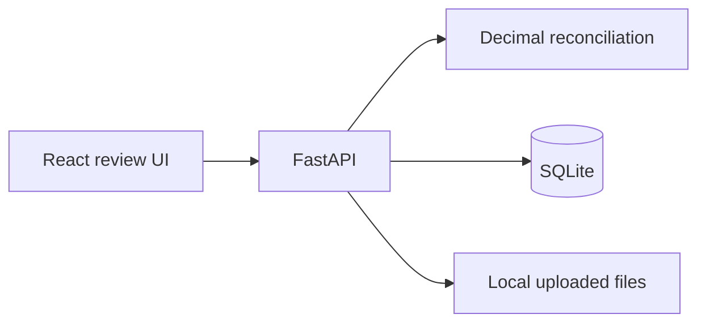

# Invoice Discrepancy Detector

Investigate invoice discrepancies with traceable evidence. Invoice Discrepancy Detector is a local-first accounts payable reconciliation MVP. It compares invoice lines against purchase orders and goods receipts with deterministic `Decimal` arithmetic, persists cases in SQLite, and supports explicit human review.

It is not an ERP, payment processor, fraud guarantee, or autonomous approver. It never initiates payment. The current version accepts normalized records through its API; uploaded documents are stored and hashed, but automatic OCR/extraction is not yet implemented.

## Quick start

Requires Python 3.11+ and Node.js 20+. From the repository root:

```bash
python3 -m venv .venv
source .venv/bin/activate
pip install -e '.[dev]'
uvicorn backend.main:app --reload
```

In another terminal:

```bash
cd frontend
pnpm install
pnpm run dev
```

Open http://localhost:5173. API docs: http://localhost:8000/docs. The UI's **Run $350 demo** submits a real reconciliation request and persists the result. Data lives under `./data`; set `INVOICE_DISCREPANCY_DETECTOR_DATA` to change its location.

## API

- `POST /api/reconcile` accepts invoice, PO, optional receipt records. Money and quantities are decimal strings.
- `GET /api/cases`, `GET /api/cases/{id}` list and inspect persisted investigations.
- `PATCH /api/cases/{id}/review` records `open`, `approved`, `rejected`, `resolved`, or `clarification_requested` and optional note.
- `POST /api/documents` stores a PDF, image, CSV, or JSON upload with SHA-256 deduplication; `GET /api/documents/{id}/file` serves it back.
- `GET /api/cases/{id}/export.json` exports a case.

Example input and demo scenario are visible in `frontend/src/main.tsx`. Results distinguish a deterministic validation status from human review status. The current matcher uses exact SKU or case-insensitive exact description; similarity suggestions and ambiguity review are not implemented.

## Architecture



## Development

```bash
pip install -e '.[dev]'
pytest
ruff check backend
cd frontend && pnpm test && pnpm run build
```

## Limitations and roadmap

This release is an early, local-first application. Uploaded JSON and CSV files are parsed as structured data; born-digital PDFs may have text extracted when the optional `documents` extra is installed. The extracted material is not yet mapped automatically into invoice, PO, or receipt records. Scanned-document OCR, provenance highlights, extraction correction, partial receipt and prior-invoice allocation, tax/discount/shipping policy, fuzzy association, evaluation datasets, and optional Ollama support are not included. Financial totals are checked when subtotal and tax were explicitly provided; missing values remain unknown rather than coerced to zero. API audit records capture case creation and review changes. Use synthetic or appropriately protected data; local storage is not encrypted.

## License

MIT. See [LICENSE](LICENSE).
