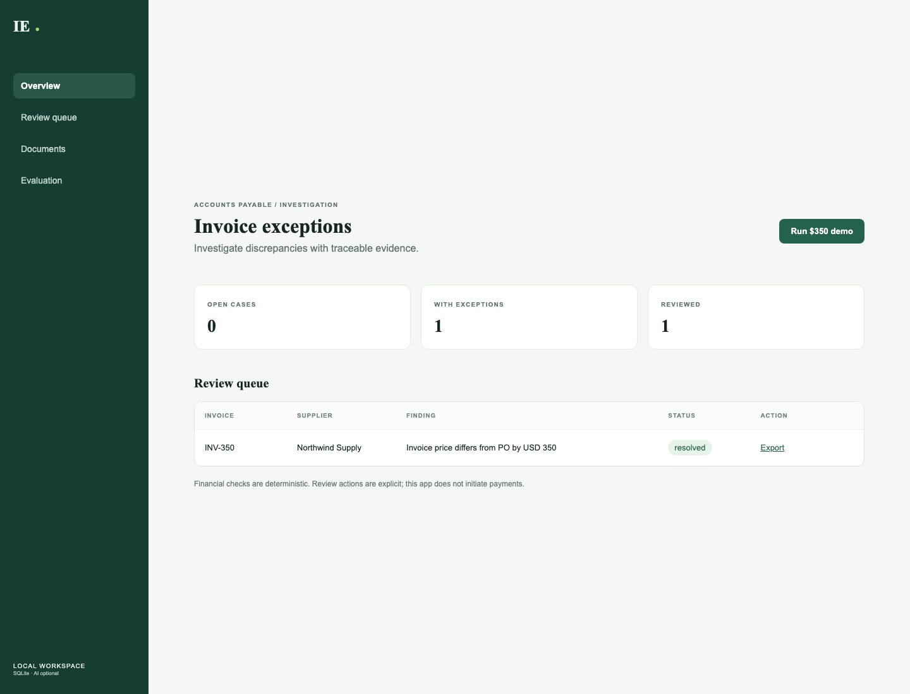
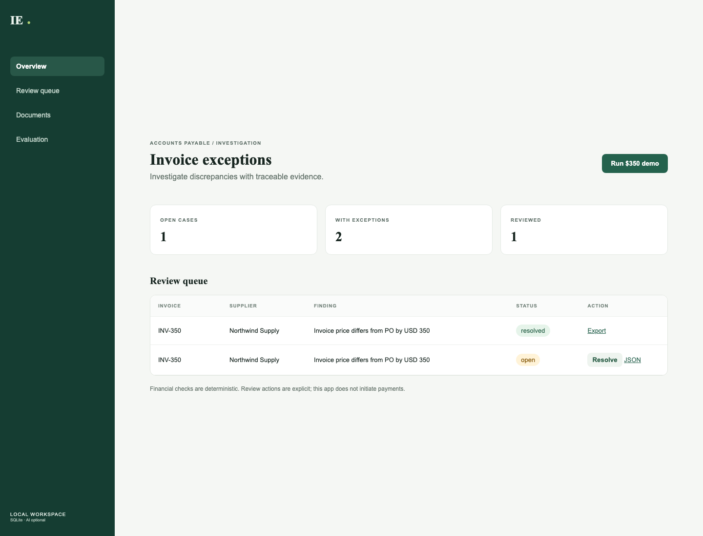
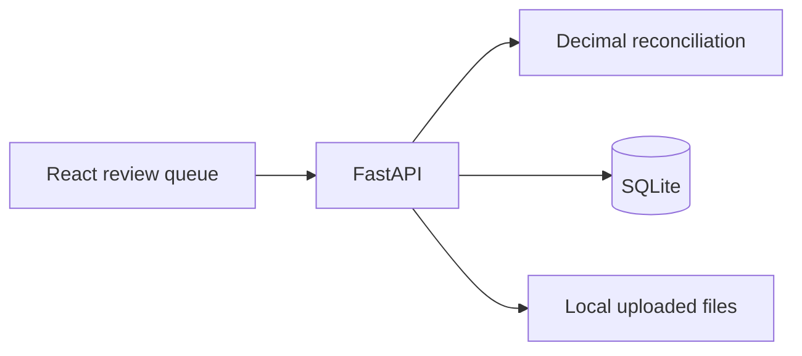

# Invoice Discrepancy Detector

Investigate accounts payable exceptions with deterministic `Decimal` checks, persisted case records, and explicit human review. The local first MVP compares normalized invoice lines with purchase orders and goods receipts, then keeps the evidence and review history in SQLite.



The example above was captured from the running application. Its demo compares an invoice price of $485 with a $450 purchase order price across 10 units and records the resulting $350 variance. Review decisions remain with a person; the application never initiates payment.

## What it does

- Compares exact SKU or case insensitive exact descriptions, quantities, currencies, PO references, receipts, and provided invoice totals.
- Shows exception calculations and the matched invoice and PO lines as evidence.
- Persists cases, documents, and review actions locally in SQLite and the local filesystem.
- Supports explicit review states and JSON or CSV exports.
- Offers a React review queue and a FastAPI API with interactive OpenAPI docs.

The matching logic is intentionally limited: ambiguous matches and similarity suggestions are not implemented. Uploaded documents are stored and hashed; JSON and CSV are parsed as structured data, and optional PDF text extraction is available. OCR and automatic mapping from document text to normalized invoice records are not included.

## Screenshots

| Review queue                                                                     | Resolved case                                                                    |
| -------------------------------------------------------------------------------- | -------------------------------------------------------------------------------- |
|  |  |

Both images show real application states produced during local execution. The demo data is synthetic.

## Requirements

- Python 3.11 or newer
- Node.js 20 or newer
- pnpm

## Run locally

From the repository root, create and activate a virtual environment, then install the backend and development dependencies:

```bash
python3 -m venv .venv
source .venv/bin/activate
pip install -e '.[dev]'
uvicorn backend.main:app --reload
```

In a second terminal, install and run the frontend:

```bash
cd frontend
pnpm install --frozen-lockfile
pnpm run dev
```

Open <http://localhost:5173>. Use **Run $350 demo** to create a persisted sample exception, then resolve it from the review queue. The API and interactive docs are at <http://localhost:8000> and <http://localhost:8000/docs>.

By default, the backend creates a `data/` directory in its current working directory. Set `INVOICE_DISCREPANCY_DETECTOR_DATA` to use another local data directory. Avoid using real invoice data unless your storage environment is appropriately protected; local files are not encrypted.

## API quick reference

- `POST /api/reconcile` — reconcile normalized invoice, PO, and optional receipt records. Monetary values and quantities can be passed as decimal strings.
- `GET /api/cases` and `GET /api/cases/{id}` — list and inspect cases.
- `PATCH /api/cases/{id}/review` — set a review state (`open`, `approved`, `rejected`, `resolved`, or `clarification_requested`) and optional note.
- `GET /api/cases/{id}/export.json` and `GET /api/cases/export.csv` — export case data.
- `POST /api/documents` and `GET /api/documents/{id}/file` — store and retrieve supported uploads (PDF, PNG, JPEG, CSV, JSON).
- `GET /api/cases/{id}/audit` — inspect case creation and review audit events.

Money and quantities should use decimal strings to avoid binary floating point surprises. The demo request is defined in [`frontend/src/main.tsx`](frontend/src/main.tsx); the API schema and examples are available from `/docs` while the backend is running.

## Architecture



## Development and checks

```bash
pip install -e '.[dev]'
ruff check backend
python -m compileall -q backend
pytest
cd frontend
pnpm install --frozen-lockfile
pnpm run build
pnpm test --passWithNoTests
```

The backend has a pytest suite. The frontend currently has no test files; its CI test command allows an empty suite while the TypeScript and Vite production build checks the UI.

## Limitations

This is an early, local first application, not an ERP, payment processor, fraud guarantee, or autonomous approver. It accepts normalized records through the API; uploaded documents are not automatically turned into invoice, PO, or receipt records. Scanned document OCR, provenance highlights, extraction correction, partial receipt and prior invoice allocation, tax/discount/shipping policy, fuzzy association, evaluation datasets, and optional Ollama support are not included. Financial totals are checked only when subtotal and tax are both provided; missing values are not treated as zero. API audit records capture case creation and review changes.

## Contributing

See [CONTRIBUTING.md](CONTRIBUTING.md) for development conventions and pull request guidance.


## License & Custom Work

[](mailto:work@withrana.com) [](https://www.linkedin.com/in/workwithrana)
[](https://www.upwork.com/freelancers/~01bbcf6edb91a8df5f)
[](https://contra.com/ranajahanzaib/)

**License:** MIT, see [LICENSE](LICENSE). Free for personal and commercial use.

**Author:** Rana Jahanzaib

**Need this built for your stack?** Email me what you're working on: work@withrana.com
